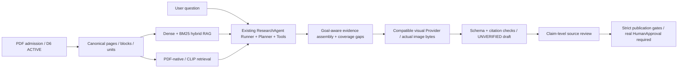

# PaperResearch v2

PaperResearch is an experimental, evidence-grounded research system for academic PDFs. It combines hybrid retrieval, an existing ResearchAgent Runner/Planner/tool/checkpoint chain, PDF-native text/table/equation units, CLIP retrieval, real image inputs to a compatible LLM provider, and source-traceable Markdown drafts.

**Engineering integration is implemented; reliable autonomous scientific research is not established.** Citation identity checks are not semantic proof. Automatic semantic verification and end-to-end strict trusted publication have not obtained full qualification. Drafts remain **UNVERIFIED** unless a separate, valid publication contract is satisfied.

## Actual case results

| Paper | Observed outcome |
| --- | --- |
| COCO-LM | A source-audited research report was delivered. Audit origin was AI, without a signed independent human review. This does not certify the original model's visual correctness. |
| Fourier Neural Operator (FNO) | First independent scientific acceptance **FAIL**, despite completion of the real multimodal execution chain. |
| U-NO | First output truncated; the separately authorized longer output produced complete JSON but failed the original citation-format gate. An offline citation-only derivative was rendered as UNVERIFIED. Final scientific acceptance **FAIL**. |

See [case results](docs/paperresearch-v2/cases.md), [technical closeout](docs/paperresearch-v2/final_report.md), and [known limitations](docs/paperresearch-v2/known_limitations.md). Negative results and historical INCOMPLETE states are retained. No automatic trusted release is enabled.

## Architecture and features



- Text retrieval remains the default; multimodal and paid generation are explicit options.
- PDF SHA, paper/unit identity, physical page, bbox, ACTIVE generation, media SHA and citation aliases are preserved.
- Goal-aware evidence assembly records selected evidence, budget limits and unresolved coverage; its independent research-quality improvement was **not** proven.
- Trace, budget accounting and Checkpoint support bounded execution and recovery.
- Evidence Contract, Evidence Graph/Wiki and semantic-review code reuse the existing project components.
- Strict `publish_reviewed` retains source, scope, atomicity and real human-approval requirements. AI-source-audited delivery is a distinct status.

Detailed [architecture](docs/paperresearch-v2/architecture.md) and [reproducibility boundaries](docs/paperresearch-v2/reproducibility.md) describe what is distributed and what requires local assets. Earlier RAG quality program results remain in [their existing report](docs/RAG_QUALITY_PROGRAM_FINAL_REPORT.md); no experimental reranker was promoted to the general production default.

## Installation

Python **3.12+** is required. Use a virtual environment and keep credentials local:

```powershell
git clone https://github.com/zhangjf314/Research.git
cd Research
git checkout release/paperresearch-v2
python -m venv .venv
.\.venv\Scripts\python.exe -m pip install -e ".[dev]"
Copy-Item .env.example .env
```

The base installation supports the API, hash baseline and offline contract tests. Optional heavy local native retrieval dependencies are declared in `.[multimodal]`; do not install them merely to run base tests. Native extraction's frozen parser requires **PyMuPDF 1.28.0**. Model weights, databases, paper PDFs and ready-built native indexes are **not bundled**.

## Configuration and startup

`.env.example` contains placeholders and safe offline defaults: `LLM_PROVIDER=template`, `LIVE_MODEL_CALLS_ENABLED=false`, `RESEARCH_DRAFT_ENABLED=false`, `LLM_VISION_ENABLED=false`. Configure database/Qdrant/Redis as appropriate. Never commit `.env`, application draft tokens or provider keys.

Use the existing Docker Compose deployment (Docker Desktop/Engine required):

```powershell
docker compose up -d --build
# Initialize tables in a fresh database; do not run against an unrelated existing database.
docker compose exec api python -c "from paper_research.db import Base,engine; import paper_research.models; Base.metadata.create_all(engine)"
Invoke-RestMethod http://localhost/api/v1/health
# Stop when finished:
docker compose down
```

UI: <http://localhost/api/v1/ui/research?mode=agent>; API specification: <http://localhost/docs>. Compose build/service startup was not re-executed for this release; static configuration and offline checks are reported in [release checks](docs/paperresearch-v2/release_checks.md).

For a preconfigured local database/Qdrant installation, the same application can run with `python -m uvicorn paper_research.main:app --host 127.0.0.1 --port 8000`. See [usage guide](docs/paperresearch-v2/usage_guide.md) for source admission and model-asset prerequisites.

## Uploading and indexing papers

Upload intake and trusted corpus admission are separate. A PDF received at `POST /api/v1/papers/upload` does not automatically gain ACTIVE authority. Direct index mutation is rejected by the D6 gate. For PDFs you are authorized to process, use the existing trusted-operator CLI in a **fresh DATA_DIR and collection**, with the full intended batch:

```powershell
# Run in the configured API container; place authorized PDFs in its local data volume first.
docker compose exec api python -m paper_research.admission status
docker compose exec api python -m paper_research.admission admit --approve --authorization-ref "local-authorized-batch" /app/data/incoming/paper.pdf
```

Admission validates PDF bytes, records operator approval and builds/seals the canonical corpus. Do not overwrite an existing admission or append to historical experiment indexes. Hosted embeddings may incur cost; the hash baseline avoids that model charge. These commands are documentation, not authorization to upload copyrighted/private material.

## Running ResearchAgent

After a compatible corpus is ACTIVE, an offline/default text task can be submitted without paid drafting:

```powershell
$request = @{query="Explain the method, experimental conditions and limitations in the admitted papers."; generate_draft=$false; multimodal_enabled=$false} | ConvertTo-Json
Invoke-RestMethod -Method Post -Uri http://localhost/api/v1/research/agent -ContentType application/json -Body $request
```

Use returned task IDs, traces and Checkpoints to inspect/resume tasks. Rule-based planning is distinguished from optional model planning. Missing evidence may produce PARTIAL; this is not scientific verification.

Actual visual drafting additionally requires a compatible vision Provider, `RESEARCH_NATIVE_BUNDLE`, a compatible `RESEARCH_NATIVE_FULL_INDEX` for the full N1/M1 backend, local model assets, explicit vision/draft switches, a locally chosen `RESEARCH_DRAFT_TOKEN`, and the `X-Research-Draft-Token` header. **Do not enable paid calls without a separately understood budget.** Application tokens do not establish a universal dollar cap; formal experiments had their own one-attempt controllers. The API's normal 4096-output limit remains and can truncate long structured drafts.

Drafts contain claim proposals, visual observations, canonical references and evidence gaps. Verify the full prose, table headers/conditions, formula completeness and image ROI, not just claim counts or SHA. See [report statuses](docs/paperresearch-v2/usage_guide.md#report-statuses).

## Tests

Run a bounded offline suite, with test outputs kept inside the project:

```powershell
$env:PYTHONDONTWRITEBYTECODE="1"
New-Item -ItemType Directory -Force .runtime/test-tmp | Out-Null
$env:TEMP=(Resolve-Path .runtime/test-tmp).Path
$env:TMP=$env:TEMP
.\.venv\Scripts\python.exe -m pytest -q -p no:cacheprovider --basetemp=.runtime/test-tmp/release tests/test_c1_report_safety.py tests/test_goal_aware_evidence_assembly.py tests/test_product_integration.py tests/test_phase1q_r2_identity.py tests/test_semantic_propositions.py tests/test_semantic_dependency_repair.py tests/test_semantic_targeted_repair.py tests/test_research_agent_state.py tests/test_research_agent_policy.py
```

These are engineering/contract tests, not verifier qualification. The one FNO historical replay test skips when its excluded raw data are absent. Some older identity/verifier tests fail against the current D6/status contracts, as reproduced in the original workspace; they are retained and documented, not silently repaired or counted as passing. Other historical suites may need private/local fixtures, services or models; a skip is not a PASS. Release test results and distribution checks are recorded in [release_checks.md](docs/paperresearch-v2/release_checks.md).

## Distribution and license

The release branch is a curated snapshot on the existing public `main`, not a push of the private development branch's 150 additional commits. It includes runnable core source, selected contract tests, necessary Phase4 runtime modules, configuration and concise documentation. It excludes credentials, raw model requests, original paper/media copies, indexes, databases, model weights and bulk experimental records. Full historical reproduction requires separately authorized assets; public source alone does not recreate the historical frozen environment.

Code is distributed under the existing [MIT License](LICENSE). Third-party libraries/models retain their own licenses. Paper and model assets are not relicensed or redistributed by this release.
