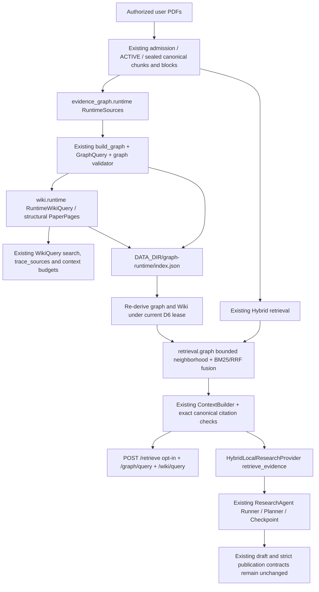

# Runtime Graph/Wiki dependencies

This is an opt-in, structural GraphRAG extension to the existing runtime. It does
not import benchmark answers into production or certify scientific support.

## Reused interfaces and research-only boundaries

| Component | Existing purpose | Runtime use |
| --- | --- | --- |
| `evidence_graph.builder.SourceData` / `build_graph` | Frozen Phase1Q-R2 / Phase2B research loader and deterministic builder | RuntimeSources overrides provenance; only canonical metadata/chunks are populated. The old filesystem loader is never called. |
| `evidence_graph.schema`, `validate`, `GraphQuery` | Typed nodes/edges, exact structure validation, neighbors and source tracing | Reused directly; only Paper, Chunk and structural CONTAINS exist. |
| `wiki.schema.Page` / Footer | Research pages with frozen-gold evidence status | RuntimePage overrides only the status to STRUCTURAL_SOURCE. Shared Footer format is retained; the runtime version/binding is separate. |
| `WikiQuery` | Frozen page constructor plus generic query APIs | Runtime constructor derives pages from validated canonical nodes; generic search/get/trace/context APIs are reused. No caller-supplied page or legacy gold validator bypass is exposed. |
| `wiki_synthesis.py`, `_r1.py`, `_r3.py` | Offline constrained generation/evaluation with research claims | Not production GraphRAG dependencies; no automatic semantic edges, summaries, judgments or new model calls. |
| `retrieval.hybrid`, BM25, RRF, ContextBuilder | Existing retrieval/ranking/context primitives | Hybrid first; optional graph neighborhood is ranked locally and fused into bounded canonical context. |
| `HybridLocalResearchProvider` / Runner / API | Existing ACTIVE tool and task execution | Same retrieve_evidence tool; GraphOptions and separate receipts are persisted with checkpoints. No second Agent or graph service. |

The structural path is **Chunk → Paper → Chunk** (maximum two hops). This can
recover other source units within the seed papers. There are no inferred
cross-paper scientific edges, similarity-as-support edges or VERIFIED claims.
Paper Wiki pages quote original chunks rather than inventing summaries. Their
titles currently use canonical paper IDs; search is the inherited literal page
search, not an additional semantic Wiki search engine.

## Authority and resource limits

Every build/query uses the existing D6 admission lease, including physical index
and canonical verification. Binding includes ACTIVE generation, inventory, seal,
index identity and canonical source digests. Page/block mappings are reconstructed
only from SHA-checked sealed parser blocks, including multi-page chunks. The
persisted graph and every Wiki field are compared with a fresh derivation; merely
rehashing a forged edge or page cannot authorize it.

The adapter accepts at most 5,000 canonical chunks and a 32 MiB graph file.
Traversal has request caps of two hops, 256 nodes and 512 edges. GraphRAG seeds
are the first five Hybrid context units. Final retrieval respects top_k and the
smaller of the requested character cap and the configured QA token budget × 4;
the existing ContextBuilder token cap also applies. Receipts expose retained,
added and lost Hybrid chunks, truncation, traversal and elapsed time. Missing
coverage is not a scientific contradiction.

This deployment retains the project's single trusted-operator corpus authority.
Requests can narrow the ACTIVE paper scope; this feature adds no tenant identity
or multi-user access-control service. Deploy separately scoped DATA_DIR/indexes
for separate authorities. Do not expose this API as a shared multi-tenant service
without an independently designed authorization boundary.
