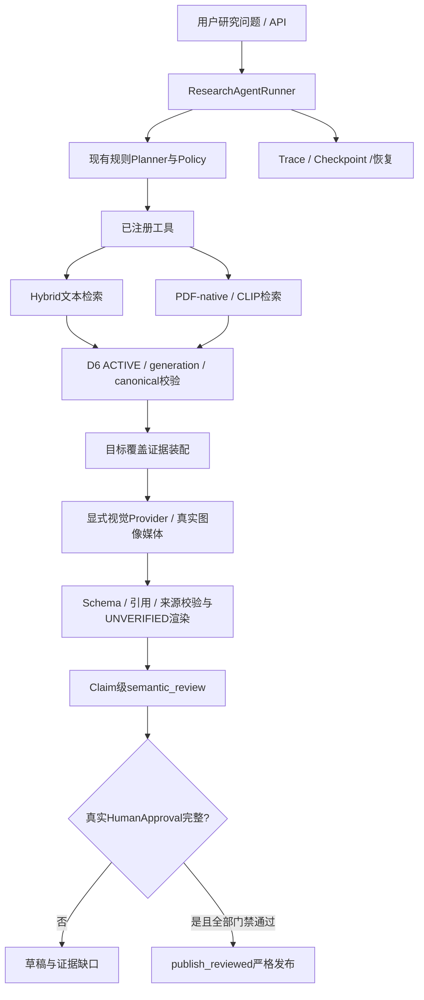

# PaperResearch v2架构冻结说明

这是现有工程的使用与证据流说明，不是新增架构。准确代码身份见release_manifest.json；冻结输入见reproducibility.md。

API入口位于`src/paper_research/api/routes/research.py`；Runner、Planner、工具、Checkpoint、装配、渲染与语义审阅在`src/paper_research/agents/research_agent/`。来源准入、索引注册与PDF原生单元沿用已有D6及Phase4实现；Phase2 Evidence Contract、Phase3 Evidence Graph/Wiki可复用，未另建第二套图谱或Agent。

文本默认沿用Hybrid检索路径；生产Embedding与个别隔离实验配置并不相同。U-NO使用隔离hash-384文本索引及既有Phase4原生多模态后端，不能将此案例当作生产Qwen文本检索的独立资格证明。CLIP提供图像检索相关性，真实视觉理解则要求Provider收到可解码图像媒体，两者不能混同。

Canonical证据携带paper、原PDF SHA、物理页、unit、模态、generation与引用别名；图像还绑定bbox和媒体SHA。ACTIVE身份仅证明来源归属及准入，不证明该片段语义支持论断。装配器需要在配额内选择上下文并报告缺口；覆盖角色命中也不证明内容充分。

生成输出经过生产Schema与引用门禁，默认UNVERIFIED。自动语义核验有独立步骤及逐命题结构，但尚未取得资格。`publish_reviewed`维持全部claim真实人工SUPPORTED、原子性、精确来源、视觉核查、范围完整性、review digest及研究范围一致等严格要求。自由研究问题/草稿不能直接作为可信事实正文。

`SOURCE_AUDITED_RELEASE`表示AI来源核查后的交付；`AI_REVIEWED_USER_ACCEPTED`表示用户采纳AI审阅。两者均不等于HUMAN_REVIEWED或TRUSTED。本次U-NO仅为离线引用规范化衍生UNVERIFIED报告，未调用严格发布器。

存储保持现有数据库、Qdrant、索引注册、原生bundle、任务JSON/Checkpoint及artifact文件。没有增加服务、数据库、训练模型或持久化权限层。服务器模型别名/fingerprint是请求身份记录，不是不可变权重保证。
